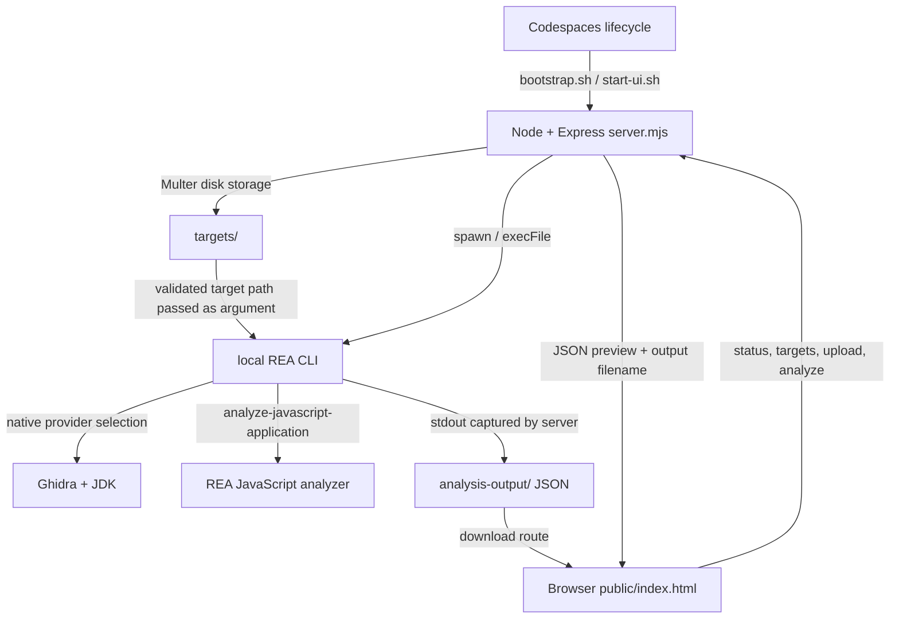

# REA Workbench — sample maintenance handover

**Public repository example:** [elsharuf107s-ux/reverse](https://github.com/elsharuf107s-ux/reverse)  
**Reviewed commit:** `ccb445f35fb378eebe8f61536370aa5aef656fae`  
**Prepared:** 2026-10-18, as an AI-assisted technical review for Ervin Mosley  
**Status:** Demonstration draft. Independent human QA and owner acceptance are pending. This is not a paid client engagement, testimonial, or endorsement by an upstream project.

REA Workbench is a small browser interface over a locally installed REA command-line tool. A maintainer should start with the request handlers in `server.mjs`, then follow the operation into REA. Native work adds Ghidra and a JDK; JavaScript analysis follows a separate REA command. The browser displays a bounded preview while the server writes the full result to disk.

The existing smoke evidence supports a working Ghidra path in this particular cloud instance. Before sharing the dashboard more widely, resolve its access boundary, analysis-job controls, and the difference between a completed bootstrap and a healthy workstation. Those are maintenance questions supported by source observations, not a security certification or a complete defect list.

## Scope and evidence

The source review covers these original repository files at the commit above. Their tracked contents were unchanged when reviewed. The new `client-ready/` sales tool is outside this sample's application scope.

| File | Why the next maintainer needs it |
| --- | --- |
| [package.json:7](https://github.com/elsharuf107s-ux/reverse/blob/ccb445f35fb378eebe8f61536370aa5aef656fae/package.json#L7) | Node requirement, runnable scripts, and three direct dependency declarations. |
| [server.mjs:10](https://github.com/elsharuf107s-ux/reverse/blob/ccb445f35fb378eebe8f61536370aa5aef656fae/server.mjs#L10) | Express application, filesystem layout, request validation, child processes, and result downloads. |
| [public/index.html:76](https://github.com/elsharuf107s-ux/reverse/blob/ccb445f35fb378eebe8f61536370aa5aef656fae/public/index.html#L76) | Browser-side state, upload handling, status requests, analysis requests, and output rendering. |
| [scripts/bootstrap.sh:4](https://github.com/elsharuf107s-ux/reverse/blob/ccb445f35fb378eebe8f61536370aa5aef656fae/scripts/bootstrap.sh#L4) | Package installation, Ghidra checksum verification, JDK prerequisites, MCP registration, and readiness commands. |
| [.github/workflows/rea-smoke.yml:9](https://github.com/elsharuf107s-ux/reverse/blob/ccb445f35fb378eebe8f61536370aa5aef656fae/.github/workflows/rea-smoke.yml#L9) | Declared GitHub Actions checks; their presence does not establish a successful remote run. |
| [.devcontainer/devcontainer.json:3](https://github.com/elsharuf107s-ux/reverse/blob/ccb445f35fb378eebe8f61536370aa5aef656fae/.devcontainer/devcontainer.json#L3) | Intended Codespaces image, Node version, forwarded port, and lifecycle hooks. |
| [scripts/start-ui.sh:3](https://github.com/elsharuf107s-ux/reverse/blob/ccb445f35fb378eebe8f61536370aa5aef656fae/scripts/start-ui.sh#L3) | Background UI startup and log/PID locations. |
| [README.md:19](https://github.com/elsharuf107s-ux/reverse/blob/ccb445f35fb378eebe8f61536370aa5aef656fae/README.md#L19) and [.gitignore:10](https://github.com/elsharuf107s-ux/reverse/blob/ccb445f35fb378eebe8f61536370aa5aef656fae/.gitignore#L10) | Intended operator workflow and exclusion of targets/results from Git. Git exclusion is not an access-control or deletion policy. |

This is a focused source review, not an exhaustive repository inventory. The local `analysis-output/` smoke artifacts were inspected as supporting instance evidence; they are ignored runtime outputs and are not available at the public source links. They must be retained privately or regenerated if a reviewer needs to reproduce the observations.

## Architecture and entry flow

The application-to-REA edges are directly visible in the reviewed code. The provider internals are conceptual boundaries drawn from the chosen CLI commands and instance outputs; Ghidra and `rea-agents` implementation code was not reviewed.

1. **Start from the repository root.** `npm run ui` runs `node server.mjs` ([package.json:11](https://github.com/elsharuf107s-ux/reverse/blob/ccb445f35fb378eebe8f61536370aa5aef656fae/package.json#L11)). The server derives `targets/`, `analysis-output/`, the REA binary, and `public/` from `process.cwd()`, so the working directory is an operational requirement ([server.mjs:11](https://github.com/elsharuf107s-ux/reverse/blob/ccb445f35fb378eebe8f61536370aa5aef656fae/server.mjs#L11)).
2. **Check readiness and discover targets.** Browser initialization calls `/api/status` and `/api/targets` ([public/index.html:90](https://github.com/elsharuf107s-ux/reverse/blob/ccb445f35fb378eebe8f61536370aa5aef656fae/public/index.html#L90)). The status handler invokes REA doctor, provider listing, REA version, and Java version with bounded subprocess timeouts ([server.mjs:73](https://github.com/elsharuf107s-ux/reverse/blob/ccb445f35fb378eebe8f61536370aa5aef656fae/server.mjs#L73)).
3. **Upload and select.** The browser sends multipart data to `/api/upload`; Multer stores one file under a timestamp-prefixed sanitized name and enforces a configured size limit ([public/index.html:88](https://github.com/elsharuf107s-ux/reverse/blob/ccb445f35fb378eebe8f61536370aa5aef656fae/public/index.html#L88), [server.mjs:64](https://github.com/elsharuf107s-ux/reverse/blob/ccb445f35fb378eebe8f61536370aa5aef656fae/server.mjs#L64)). The default limit is 8 GiB. Browser-side checks improve feedback; the server-side limit is the enforcement point.
4. **Choose an operation.** `/api/analyze` checks an operation allowlist, validates that the target path exists under `targets/`, and requires a query for selected operations. It builds an argument array and launches REA without a shell command string ([server.mjs:130](https://github.com/elsharuf107s-ux/reverse/blob/ccb445f35fb378eebe8f61536370aa5aef656fae/server.mjs#L130)). JavaScript analysis uses `analyze-javascript-application`; native operations request the Ghidra provider. These checks do not independently establish containment of symlink targets or safety of all analyzed files.
5. **Collect and view evidence.** REA stdout is streamed into an output file; a preview and stderr are retained for the response. The browser displays response content through `textContent` and exposes the output download link ([server.mjs:157](https://github.com/elsharuf107s-ux/reverse/blob/ccb445f35fb378eebe8f61536370aa5aef656fae/server.mjs#L157), [public/index.html:89](https://github.com/elsharuf107s-ux/reverse/blob/ccb445f35fb378eebe8f61536370aa5aef656fae/public/index.html#L89)). The download route reads from `analysis-output/` ([server.mjs:119](https://github.com/elsharuf107s-ux/reverse/blob/ccb445f35fb378eebe8f61536370aa5aef656fae/server.mjs#L119)).

## Dependencies and setup handover

The manifest declares `express` `^5.1.0` for HTTP handling, `multer` `^2.0.2` for upload storage, and `rea-agents` `6.5.0` for analysis workflows ([package.json:23](https://github.com/elsharuf107s-ux/reverse/blob/ccb445f35fb378eebe8f61536370aa5aef656fae/package.json#L23)). These are declarations, not a complete installed dependency bill of materials or a vulnerability assessment.

The intended devcontainer is Ubuntu 24.04 with Node 24.11.0 and npm 11; the package accepts Node `>=24.11.0`. Bootstrap installs a full JDK 21, downloads Ghidra 12.1.4 from its release URL, and checks the archive against a pinned SHA-256 before extraction ([scripts/bootstrap.sh:4](https://github.com/elsharuf107s-ux/reverse/blob/ccb445f35fb378eebe8f61536370aa5aef656fae/scripts/bootstrap.sh#L4), [scripts/bootstrap.sh:28](https://github.com/elsharuf107s-ux/reverse/blob/ccb445f35fb378eebe8f61536370aa5aef656fae/scripts/bootstrap.sh#L28)). Do not bypass that verification to repair an installation failure.

Relevant configuration names are `PORT`, `MAX_UPLOAD_GB`, `GHIDRA_INSTALL_DIR`, `JAVA_HOME`, and `REA_ANALYSIS_PROVIDER` ([server.mjs:15](https://github.com/elsharuf107s-ux/reverse/blob/ccb445f35fb378eebe8f61536370aa5aef656fae/server.mjs#L15)). The reviewed source does not require an application API key for the demonstrated local workflow. Optional MCP clients/providers may have separate requirements and data-handling terms.

The current instance uses Node 24.19.0, Ghidra 12.1.4, and a full JDK 21.0.8 on Debian 13, with supported tool-path overrides supplied during onboarding. That successful instance does not prove that a fresh Ubuntu devcontainer rebuild or the repository's privileged bootstrap will complete unchanged on another host.

## Five maintenance questions

Effort bands below are indicative engineering investigation and initial implementation time for someone familiar with Node, excluding procurement, platform changes, and a complete regression suite. They are neither fixed quotes nor promises. Confirm requirements and reproduce relevant behavior before commissioning changes.

| Priority | Question and observed evidence | Why it matters / next evidence | Indicative effort |
| --- | --- | --- | --- |
| Before wider sharing | **Who may reach the dashboard?** The app binds `0.0.0.0`, and the reviewed server does not implement user authentication or authorization ([server.mjs:206](https://github.com/elsharuf107s-ux/reverse/blob/ccb445f35fb378eebe8f61536370aa5aef656fae/server.mjs#L206)). The devcontainer forwards port 3000; that declaration alone does not reveal actual port visibility. | Confirm Codespaces/cloud proxy access controls and intended users. Test access from an unauthenticated session before sharing. Decide whether the supported mode is a private single-user workstation or needs additional application controls. No public exposure or exploit was demonstrated by this review. | 0.5–1 day to verify and document the boundary; authentication implementation needs its own scope. |
| Next | **What bounds an analysis job and guarantees its output is ready?** Unlike `runSmall`, the analysis `spawn` path has no application timeout, queue, cancellation, or concurrency limit. Output is written without an explicit write-stream error/backpressure handler; the response follows child close rather than confirmed file-stream completion ([server.mjs:160](https://github.com/elsharuf107s-ux/reverse/blob/ccb445f35fb378eebe8f61536370aa5aef656fae/server.mjs#L160)). | Agree CPU/time/disk limits and retention, then test disconnects, slow/full storage, concurrent jobs, and immediate download. These are uncovered failure paths; no load or disk-failure test was performed. | 1–3 days for a bounded lifecycle design and representative checks. |
| Next | **When is bootstrap genuinely ready?** MCP setup and provider doctor end with `|| true`, followed by “Bootstrap complete” ([scripts/bootstrap.sh:49](https://github.com/elsharuf107s-ux/reverse/blob/ccb445f35fb378eebe8f61536370aa5aef656fae/scripts/bootstrap.sh#L49)). The Java default is a Linux x64 path; platform assumptions are not validated there. | Define required Ghidra/JDK checks separately from optional MCP registration. Prove that a missing required tool produces an actionable unsuccessful readiness result. Preserve a passing optional-provider distinction. | 0.5–1 day for readiness criteria, checks, and documentation. |
| Plan | **How will installations be reproduced?** No tracked lockfile was found at this commit. Bootstrap and CI use `npm install`, while Express/Multer use version ranges ([scripts/bootstrap.sh:11](https://github.com/elsharuf107s-ux/reverse/blob/ccb445f35fb378eebe8f61536370aa5aef656fae/scripts/bootstrap.sh#L11), [.github/workflows/rea-smoke.yml:21](https://github.com/elsharuf107s-ux/reverse/blob/ccb445f35fb378eebe8f61536370aa5aef656fae/.github/workflows/rea-smoke.yml#L21)). | Decide the lockfile/update policy, record a known installed tree, and test a clean frozen install after a separately reviewed repository change. A later install may otherwise resolve differently; this review did not compare two clean installs. | 0.5–1 day, plus time to resolve any dependency incompatibility found. |
| Plan | **Which observable behaviors must CI protect?** The workflow installs dependencies, checks server syntax, and runs REA CLI help. It does not start the dashboard or exercise upload/analyze/download. There is no test/check script in the reviewed package ([.github/workflows/rea-smoke.yml:24](https://github.com/elsharuf107s-ux/reverse/blob/ccb445f35fb378eebe8f61536370aa5aef656fae/.github/workflows/rea-smoke.yml#L24), [package.json:10](https://github.com/elsharuf107s-ux/reverse/blob/ccb445f35fb378eebe8f61536370aa5aef656fae/package.json#L10)). | Add inexpensive HTTP boundary tests with controlled fixtures; keep heavyweight native-provider smoke checks distinct. First agree expected status codes, malformed-input behavior, and output-download integrity. External tests may exist outside this review. | 1–2 days for a representative API suite and CI wiring. |

## Verification handover

### Observed in this instance

These are narrow onboarding observations from 2026-10-18, not the results of an exhaustive product test suite. The evidence files below are local runtime artifacts; private copies or regeneration are needed for independent review.

| Observation | Supporting evidence | Practical limit |
| --- | --- | --- |
| Dashboard status reached REA 6.5.0, Java, and the Ghidra provider successfully. | `analysis-output/status.json`, `analysis-output/doctor.json`, and dashboard response captured during onboarding. | Doctor reported `healthy: true` for the explicitly selected Ghidra scope and `environment_healthy: false` overall, with optional providers/MCP configuration outstanding. Do not label every integration healthy. |
| Native analysis produced an overview for the compiled onboarding fixture. Its C source defines `main` returning 42. | `analysis-output/native-smoke.json`, `analysis-output/smoke.c`; target digest `7b01dd736eae249df3d1c401058279fa5b565aae99cdd08595d8aae8f66e1eda`. | One small ELF fixture; no general binary-format, architecture, or large-file coverage is established. |
| The decompile API returned success and Ghidra pseudocode containing `return 0x2a`. | `analysis-output/decompile-smoke.json` and the output JSON named in its response. | This matches the fixture's source constant; it does not prove behavioral equivalence of arbitrary decompiled code. |
| The JavaScript API fixture returned success. | `analysis-output/javascript-smoke.json` and the output JSON named in its response. | One controlled JavaScript directory; no complete Electron/ASAR or dynamic behavior coverage. |
| The original server passed a Node syntax check during onboarding. | `node --check server.mjs`, also repeated for this sample review. | Syntax validity only; no behavioral assertions. |

### Next maintainer's repeatable check

Use an isolated workspace, an authorized source snapshot, controlled target fixtures, and injected non-secret tool configuration. Installation and analysis execute third-party tools, so a static-only engagement should hand these steps to the owner or obtain a separate execution scope first. Commands below describe the handover procedure; they are not a claim that each was rerun while preparing this note.

1. Record the checkout commit, host, `node --version`, `npm --version`, `java -version`, and tool versions. Check that `GHIDRA_INSTALL_DIR` and `JAVA_HOME` point to the intended installations. Reuse approved outputs instead of blindly rerunning the privileged bootstrap.
2. In a disposable setup copy, follow the documented dependency/bootstrap path and record installation output and the resolved dependency tree. The current commit has no tracked lockfile, so do not claim `npm ci` is supported until a lockfile policy is implemented.
3. Run `node --check server.mjs`, `npm run rea -- doctor --provider ghidra --json`, and `npm run rea:providers`. Review required provider checks and optional integrations separately.
4. Start `npm run ui` from the repository root. Request `http://127.0.0.1:3000/api/status` and `/api/targets`; then inspect the browser for status and selection behavior. Validate real forwarding permissions independently.
5. Upload a known harmless native fixture through the browser, request native analysis, decompile its known `main`, and download the resulting JSON. Compare the download with the generated disk artifact and inspect its success/error fields. Repeat the JavaScript operation using an authorized directory fixture.
6. In a separate behavioral test task, exercise missing targets, disallowed operations, missing queries, upload-limit rejection, tool failures, symlink handling, cancelled requests, and output-stream failures. Record exact commands, exit/status codes, target digests, expected assertions, and observed outputs.

The upstream workflow's last remote result was not checked. Fresh-task restoration, a clean Codespaces rebuild, concurrency, maximum-size uploads, and all supported operations remain unverified.

## Delivery limits and sign-off

This example excludes dependency vulnerability and license audits, penetration testing, production access, performance certification, large-file stress testing, package internals, Ghidra/JDK implementation review, and changes to the original application. Public source availability does not by itself settle rights to redistribute third-party code or binaries; the sample links to source rather than bundling them.

Architecture statements above distinguish source-observed calls from provider boundaries. Maintenance priorities are proposed for discussion, with uncertainty and next checks visible. The onboarding smoke observations are explicitly broader than a static-only paid review and must not be copied into an unrelated client's report as though their system had been tested.

**Pending independent human QA:** verify the commit and cited lines, check the diagram against the named source, reproduce or inspect retained smoke evidence, validate the maintenance priorities with the owner, and approve redaction and sharing. No human-reviewed completion or client acceptance is claimed.
